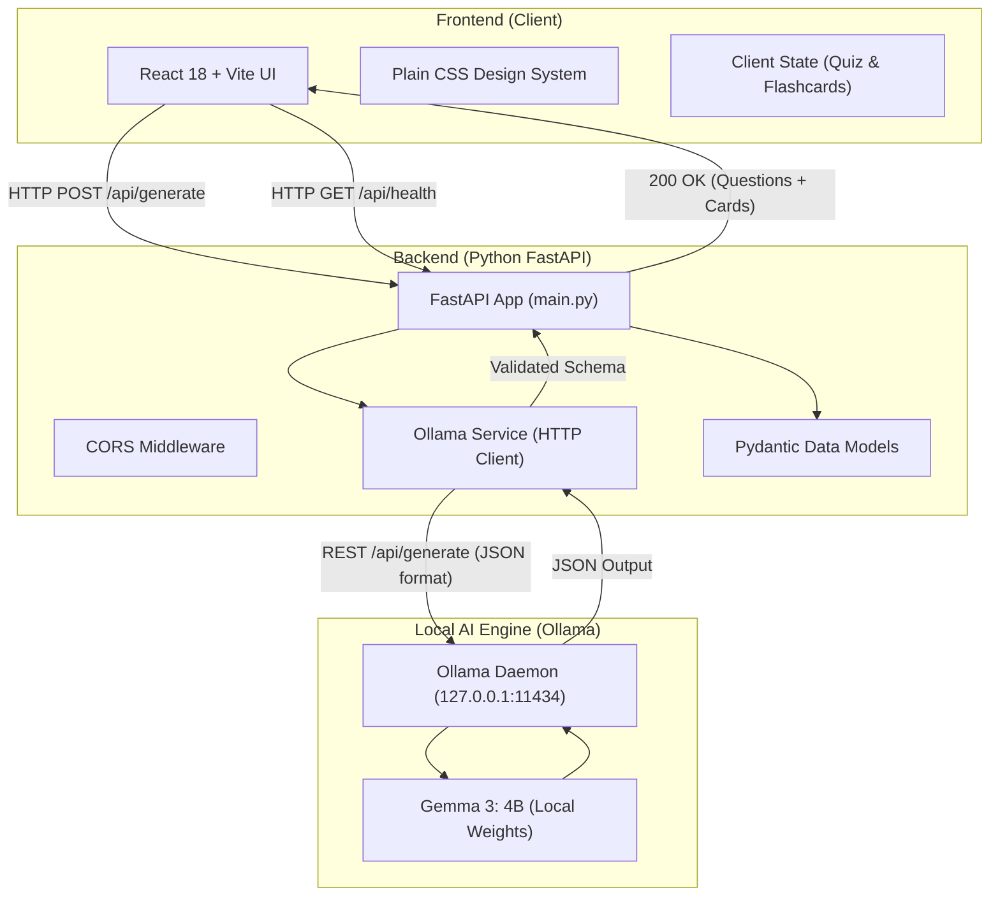

# RecallKit AI - Architecture Document

## 1. High-Level Architecture Overview

RecallKit AI follows a clean, decoupled 2-tier client-server architecture backed by a local AI inference engine.



---

## 2. Component Breakdown

### 2.1 Frontend (`frontend/`)
- **Technology:** React 18, Vite, Vanilla CSS.
- **Role:**
  - Provides a modern, responsive interface for inputting study notes.
  - Checks backend and Ollama health upon initial load and displays real-time connection badges.
  - Manages client-side interaction:
    - Tab switching between "Quiz Mode" and "Flashcards".
    - Interactive 3D flip card state and navigation counters.
    - Quiz selection state, grading logic, score computation, and answer explanation reveals.
- **Styling Architecture:**
  - Token-based CSS variables in `index.css` (color system, spacing, shadows, radius, transitions).
  - Dedicated component styles (`App.css`) without heavy external utility frameworks.

### 2.2 Backend (`backend/`)
- **Technology:** Python 3.10+, FastAPI, Uvicorn, HTTPX, Pydantic v2.
- **Role:**
  - Acts as a resilient bridge between the web client and Ollama.
  - Validates client payloads and sanitizes user input.
  - Enforces JSON output format from Ollama using prompt engineering and Ollama's native `format: "json"` option.
  - Parses and validates AI output using Pydantic models before responding to the frontend.
  - Provides detailed, actionable error responses if Ollama is offline or uncommunicative.

### 2.3 Local AI Runtime (`Ollama`)
- **Address:** `http://127.0.0.1:11434`
- **Target Model:** `gemma3:4b`
- **Inference Mechanism:** Local GPU or CPU acceleration via llama.cpp runner. Zero cloud network calls.

---

## 3. Data Models & API Contracts

### 3.1 Health Check Endpoint
- **Route:** `GET /api/health`
- **Response Model:**
  ```json
  {
    "status": "ok",
    "ollama_connected": true,
    "model": "gemma3:4b",
    "available_models": ["gemma3:4b", "qwen3.5:4b"]
  }
  ```

### 3.2 Generation Endpoint
- **Route:** `POST /api/generate`
- **Request Body:**
  ```json
  {
    "notes": "string (min length: 50)"
  }
  ```
- **Response Body:**
  ```json
  {
    "quiz": [
      {
        "id": 1,
        "question": "What is the primary function of mitochondria?",
        "options": [
          "Protein synthesis",
          "ATP production via cellular respiration",
          "Lipid storage",
          "DNA transcription"
        ],
        "correct_index": 1,
        "explanation": "Mitochondria generate most of the chemical energy needed by the cell in the form of ATP."
      }
    ],
    "flashcards": [
      {
        "id": 1,
        "front": "What role do mitochondria play in cellular biology?",
        "back": "They serve as the powerhouse of the cell, generating ATP."
      }
    ]
  }
  ```

---

## 4. Error Handling & Resilience
1. **Ollama Offline (Connection Refused):**
   - Caught by `httpx.ConnectError`.
   - Returns HTTP `503 Service Unavailable` with message: `"Local Ollama server is not running at http://127.0.0.1:11434. Please start it using 'ollama serve'."`
2. **Model Not Found:**
   - Returns HTTP `404 Not Found` with message: `"Model 'gemma3:4b' was not found in Ollama. Available models: [...]"`.
3. **Malformed LLM Output:**
   - Fallback parser strips markdown code blocks (````json ... ````) before validation.
   - If parsing still fails, returns HTTP `502 Bad Gateway` with clear diagnosis.
